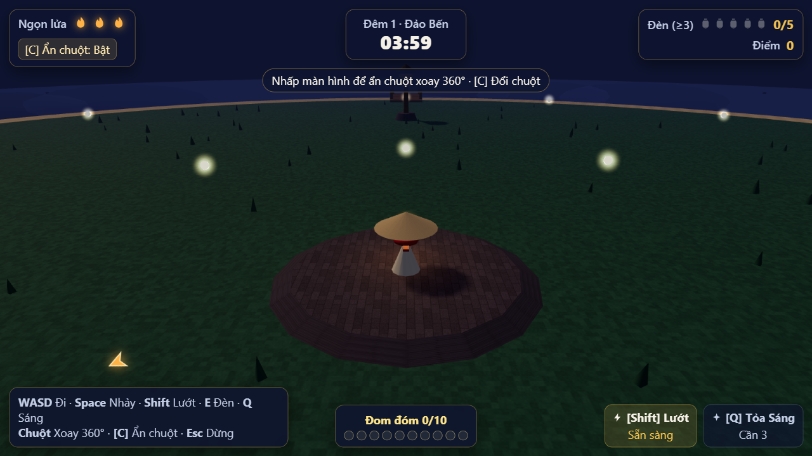

# Đảo Đèn Lồng (Lantern Island) — v1.0.0 (Phase 4)

> **Video Demo (< 5 phút):** [Tải / xem `demo.mp4` đính kèm Release `v1.0.0`](https://github.com/bquang016/K5-L3A-DAY12-BuiDangQuang-2A202603640-AI-SDLC-Dao-Den-Long/releases/tag/v1.0.0) *(hoặc xem `docs/demo/demo.mp4` sau khi đính kèm bản phát hành)*  
> **Phiên bản:** `v1.0.0` · **Test Contract:** `v1.3` ([game.contract.json](game.contract.json)) · **Tag nộp:** `phase-4`



Game phiêu lưu hành động 3D góc nhìn thứ ba bằng Three.js + Web Audio với lõi mô phỏng **60 Hz tất định** tách biệt hoàn toàn khỏi phần hiển thị. Người chơi điều khiển **Mây** vượt qua 3 Đêm (*Đảo Bến*, *Đảo Cau*, *Đảo Chuông*), thu thập Đom đóm để thắp và châm dầu giữ đủ số Đèn Lồng Lớn sáng tới **Bình Minh** trước sự truy đuổi và hút dầu của **Bóng Mực**, **Gió Lạc** và gió mạnh.

---

## Yêu cầu hệ thống

- **Node.js >= 20** (khuyến nghị `v22.x`) và **npm** (macOS, Linux, Windows).
- Trình duyệt có **WebGL2** (Chrome, Edge, Firefox, Safari) để chơi 3D; máy chạy **Chrome / Chromium / Edge** để tự đo benchmark cửa sổ `1280×720`.
- Hoặc **Docker** nếu muốn đóng gói và chạy trong container độc lập.

---

## Cài đặt & Chạy (tối đa 3 lệnh từ repo sạch)

```bash
git clone https://github.com/bquang016/K5-L3A-DAY12-BuiDangQuang-2A202603640-AI-SDLC-Dao-Den-Long.git && cd K5-L3A-DAY12-BuiDangQuang-2A202603640-AI-SDLC-Dao-Den-Long
npm install && npm run build
npm start
```

Mở trình duyệt tại địa chỉ in ra trên terminal (mặc định `http://localhost:4173`).  
*(Hoặc chạy chế độ phát triển nóng bằng `npm run dev` tại `http://localhost:5173`; bảng xếp hạng đều tự động lưu vào đĩa cục bộ ở cả hai chế độ.)*

### Chạy bằng Docker (tùy chọn phát hành)

```bash
docker build -t dao-den-long:1.0.0 .
docker run -p 4173:4173 dao-den-long:1.0.0
```

---

## Điều khiển & Dễ tiếp cận (Accessibility)

Mọi phím dưới đây đều có thể **đổi tự do** trong **Cài đặt & Phím** (tự động phát hiện trùng phím, kèm nút **Khôi phục mặc định** và tự lưu):

| Hành động mặc định | Phím mặc định | Mô tả |
|---|---|---|
| Di chuyển | `W A S D` *(hoặc mũi tên nếu chưa gán việc khác)* | Chạy `6.0 m/s`, điều khiển đầy đủ trên không |
| Nhảy | `Space` | Nhảy `7.0 m/s`, trọng lực `-20 m/s²` |
| Lướt | `Shift` | Lướt `14 m/s` trong `0.2s`, hồi `1.5s`, giữ nguyên độ cao |
| Tương tác / Châm dầu | `E` *(hoặc `F` / `Enter`)* | Nạp đom đóm (`10` thắp mới, `5` thắp lại) hoặc châm `+10` dầu/đom đóm |
| Tỏa Sáng | `Q` *(hoặc `X`)* | Tốn `3` đom đóm, đẩy `4 m` & làm choáng Bóng Mực `2s` (`5 m` 3D) |
| Xoay Camera & Zoom | `Chuột` + `Cuộn` · `[C]` | Xoay 360° (bật/tắt chế độ **ẩn chuột Pointer Lock** bằng phím `C`) |
| Tạm dừng / Tắt tiếng | `Esc` *(hoặc `P`)* · `M` | Mở menu Tạm dừng / tắt nhanh âm thanh |

**Tùy chọn trợ năng tích hợp sẵn:**
- **Cỡ chữ UI >= 18 px tại `1280×720`** kèm tùy chọn **Chữ lớn (`×1.25`)**.
- **Giảm chuyển động:** Tắt rung camera, thu phóng FOV khi lướt và hiệu ứng chớp màn hình.
- **Phụ đề & chỉ báo hình ảnh:** Cảnh báo chữ kèm mũi tên mép màn hình khi Bóng Mực vừa xuất hiện, cảnh báo gió mạnh sắp thổi, đếm ngược `10s` cuối và đèn có `fuel < 30`.
- **Chế độ Mù màu:** Đổi viền/mắt Bóng Mực sang `#00B3FF`, cảnh báo `#FFFFFF` + `⚠`, đèn tắt xẹp `20%` kèm vết rách.

---

## Bảng xếp hạng cục bộ (Local Leaderboard)

- Sau khi thắng Bình Minh (Đêm 3) hoặc thua ở bất kỳ Đêm nào, người chơi nhập tên (`3–12` ký tự `[A-Za-z0-9_]` hoặc tiếng Việt có dấu) để lưu tổng điểm các Đêm đã thắng.
- Giữ **Top 10** sắp xếp theo `score` giảm dần (bằng điểm thì `achieved_at` sớm hơn đứng trên), lưu trên đĩa cục bộ (`~/.dao-den-long/leaderboard.json`, có thể đổi đường dẫn qua biến môi trường `DAO_DEN_LONG_LEADERBOARD_PATH`).
- Xem trực tiếp từ nút **Bảng xếp hạng** trên Menu chính hoặc xuất JSON chuẩn bằng lệnh:

```bash
node scripts/run.js --export-leaderboard out.json
```

---

## Kiểm thử, Headless, Benchmark & Soak Test (Contract v1.3)

| Mục đích | Lệnh chạy | Kết quả / Ghi chú |
|---|---|---|
| **Kiểm chứng toàn phần** | `npm run verify` | Chạy đồng bộ Contract `v1.3`, `36` unit + contract tests, `--export-leaderboard`, quick soak, determinism 3 Đêm, hiệu năng Đêm 3 và Vite build |
| **Bộ test đơn vị & hợp đồng** | `npm test` | `36/36` tests qua `node --test` |
| **Chạy Headless 60Hz** | `node src/headless/cli.js --seed 42 --night 3 --ticks 18000 --out out.jsonl` | Xuất JSONL tất định (`<= 30s`, mã thoát `0`, `2` lỗi JSON/schema, `1` lỗi CLI) |
| **Benchmark 3D `1280×720`** | `node scripts/bench.js --seed 42 --duration 30 --out bench.json` | Đêm 1 chuẩn, `200` Bóng Mực `wander` + `100` đom đóm + `L1–L3` sáng, tắt sáng tạo, camera quay vòng `r=30m, Y=15m` |
| **Soak Test 10 Đêm** | `node --max-semi-space-size=1 --no-concurrent-recompilation --optimize-for-size --expose-gc scripts/soak.js --seed 7 --nights 10 --out soak.json` | Chạy `10` đêm liên tiếp xoay vòng Đêm `1→2→3`, `0` crash, RSS ổn định (`<= 1.2×` lúc đầu) |

> **Lưu ý kỹ thuật về VSync trong Benchmark (`vsync_off: true`):**  
> `scripts/bench.js` khởi chạy Chromium/Chrome với `--disable-gpu-vsync --disable-frame-rate-limit` để đo vượt ngưỡng làm tươi màn hình. WebGL trên một số hệ điều hành có bộ tổng hợp cửa sổ (compositor) hoặc trình điều khiển GPU ép đồng bộ riêng vẫn có thể bị giới hạn bởi phần cứng OS, nhưng cờ tắt VSync cấp trình duyệt đã được kích hoạt đầy đủ (đạt **`99.6 FPS`** trung bình trên bản tự đo tại [bench.json](bench.json)).

---

## Sáng tạo của tôi

Toàn bộ tính năng sáng tạo nằm gói gọn trong `src/game/`, **tự động tắt khi chạy Headless, Benchmark (`?bench=1`) và Soak Test** để không làm sai lệch số liệu chuẩn:

1. **Dòng đom đóm dẫn đường thích ứng (`src/game/renderer.js`):** Tự động chỉ hướng về đèn sắp cạn dầu (`fuel < 30`) hoặc đèn tắt gần nhất khi Mây đủ ánh sáng để thắp/thắp lại.
2. **Đèn trời & Lời dẫn Ông Đăng (`src/game/renderer.js`, `src/game/hud.js`):** Thả đèn trời khi thắp đèn và hướng dẫn luật từng Đêm theo cốt truyện cổ tích.
3. **Âm thanh ngũ cung Web Audio & Đồ họa PBR thủ tục (`src/game/audio.js`, `src/game/textures.js`, `src/game/input.js`):** Nhạc/SFX tổng hợp thời gian thực, texture thủ tục gỗ/cỏ/cát/đá, cỏ lay gió và chế độ ẩn chuột xoay 360° (`C`).

**Bằng chứng tính toàn vẹn phần lõi:** `tests/unit.test.js` kiểm tra tĩnh `src/sim/` và `src/headless/` không chứa bất kỳ phụ thuộc `three` hay hàm ngẫu nhiên hệ thống nào; `npm run verify` xác nhận tính tất định khớp từng byte SHA-256 trên cả 3 Đêm.

---

## Tài liệu SDLC, Retro & Bằng chứng

- **Retro tổng kết 4 Phase:** [docs/notes/retro.md](docs/notes/retro.md)
- **Bằng chứng kiểm chứng:** [Phase 4](docs/proof/phase-4.md) · [Phase 3](docs/proof/phase-3.md) · [Phase 2](docs/proof/phase-2.md) · [Phase 1](docs/proof/phase-1.md)
- **Kết quả tự đo đã commit:** [bench.json](bench.json) · [soak.json](soak.json)
- **Kiến trúc & Thay đổi:** [ADR-001](docs/notes/adr-001-lantern-fuel-and-dawn-survival.md) · [CHANGELOG.md](CHANGELOG.md) · [docs/notes/ai-log.md](docs/notes/ai-log.md)
- **Harness AI:** [AGENTS.md](AGENTS.md) · [verify-phase](.agents/skills/verify-phase/SKILL.md) · [pre-commit](.githooks/pre-commit) · [CI](.github/workflows/ci.yml)
- **Nguồn gốc & Giấy phép:** [CREDITS.md](CREDITS.md) · [LICENSE](LICENSE)
